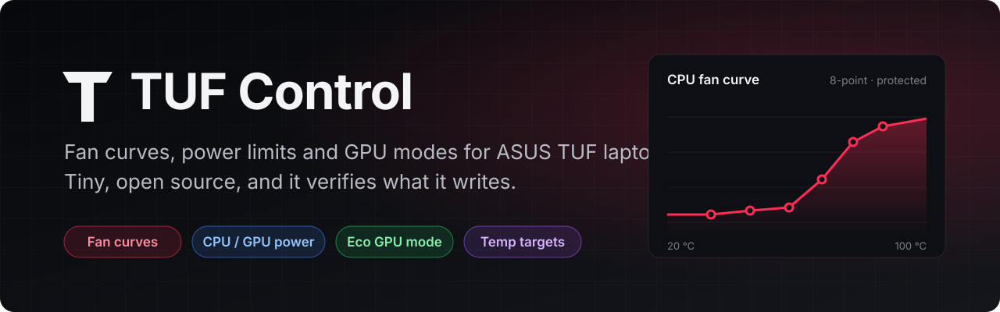
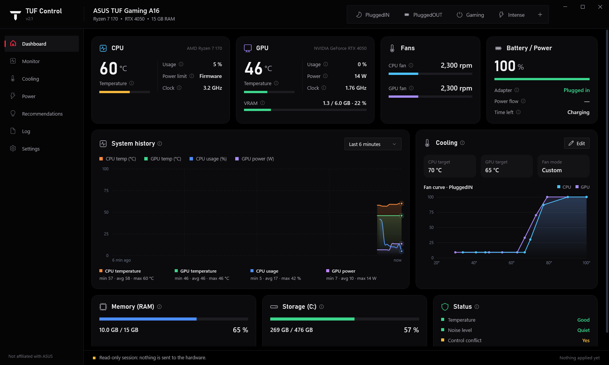
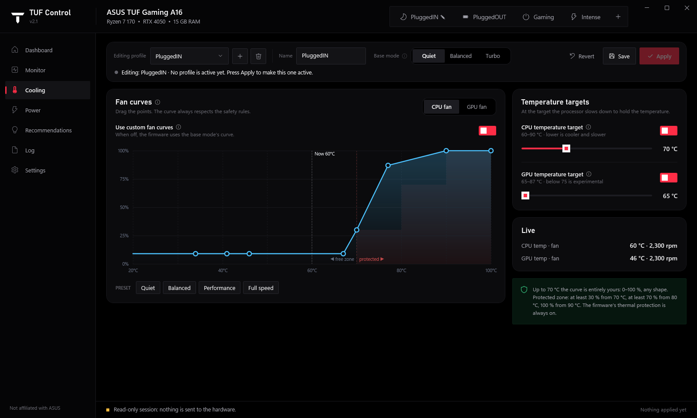
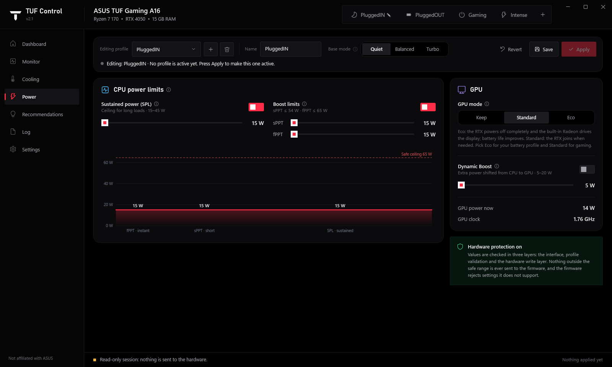
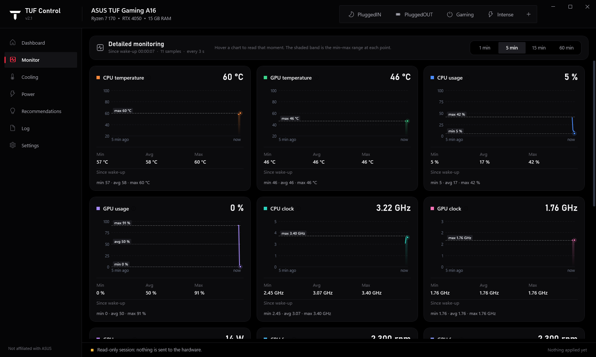
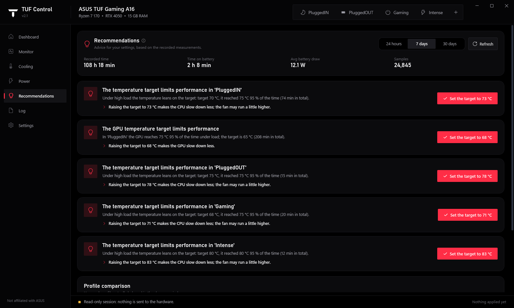
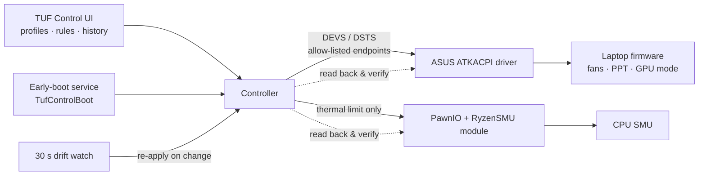

<p align="center">
  
</p>

<p align="center">
  <a href="https://github.com/atakang7/tuf-control/actions/workflows/build.yml"></a>
  <a href="https://github.com/atakang7/tuf-control/releases/latest"></a>
  <a href="https://github.com/atakang7/tuf-control/releases"></a>
  <a href="LICENSE"></a>
  
  
</p>

<p align="center">
  <b>Fan curves, CPU/GPU power limits, temperature targets and Eco GPU mode for ASUS TUF laptops —<br>
  in an app under 1 MB that keeps your settings applied even when Armoury Crate or ASUS services fight back.</b>
</p>

<p align="center">
  
</p>

## Why

Armoury Crate is heavy, reinstalls itself and quietly resets your fan and power settings.
TUF Control does the one job well:

- **Applies your profile and checks it stuck.** After every write it reads back everything the
  firmware exposes, writes again on a mismatch, and fails loudly if the values still differ.
- **Wins against ASUS services.** If Armoury Crate, `ASUSOptimization` or G-Helper is running,
  TUF Control overrides them instead of giving up, and re-applies within 30 s if they change
  something.
- **Applies before you sign in.** An optional early-boot service sets fans and power limits
  seconds after Windows starts, so you skip the loud-fan first minute.
- **Learns from your usage.** It records temperatures per profile and suggests better targets.

## Features

| | |
|---|---|
| 🌀 **Custom fan curves** | 8-point CPU and GPU curves, with a protected zone you can't undercut |
| ⚡ **CPU power limits** | SPL, sPPT and fPPT, clamped to safe ranges |
| 🎮 **GPU tuning** | Dynamic Boost, GPU temperature target, **Eco** (dGPU off) / Standard modes |
| 🌡️ **CPU temperature target** | Ryzen SMU thermal limit, verified from the SMU table |
| 🔁 **Automatic profiles** | Plugged in / on battery / per-app rules (e.g. a game launches → *Gaming*) |
| 📈 **Monitoring** | Live and historical CPU/GPU temperature, load, clocks, power and fan speed |
| 💡 **Recommendations** | Suggestions from your recorded data, applied with one click |
| 🖥️ **External display aware** | Keeps the RTX on while HDMI is connected |
| 🌍 **English / Türkçe** | Switches instantly |

<table>
  <tr>
    <td></td>
    <td></td>
  </tr>
  <tr>
    <td></td>
    <td></td>
  </tr>
</table>

## Compatibility

TUF Control writes to firmware, so it is strict about where it runs. These rules are enforced
in code ([`src/Platform.cs`](src/Platform.cs)), not just documented.

| | Rule | What happens otherwise |
|---|---|---|
| **Operating system** | Windows 10 2004 (build 19041) or newer, Windows 11 recommended | App refuses to start |
| **Architecture** | x64 only (OS and process). No ARM64, no 32-bit | App refuses to start |
| **Laptop model** | Verified: **ASUS TUF Gaming A16 FA607NUQ** | Runs **read-only**: monitoring works, nothing is written |
| **BIOS** | Tested: **FA607NUQ.300** (2026-01-08) | Runs, with a warning in the log |
| **ASUS driver** | ASUS System Control Interface v3 (`ATKACPI`), installed by Windows Update / MyASUS | Fan, mode and power controls unavailable |
| **CPU temperature target** | AMD Ryzen 6000-series "Rembrandt" / "Rembrandt-R" (e.g. Ryzen 7 7735HS, Ryzen 7 170) and the [PawnIO](https://github.com/namazso/PawnIO) 2.x driver | That one feature is disabled; everything else works |
| **GPU readings** | NVIDIA driver (for temperature, clock, power) | GPU sensors show "—" |
| **Runtime** | [.NET 10 Desktop Runtime](https://dotnet.microsoft.com/download/dotnet/10.0) x64 | Windows offers to install it |
| **Linux / macOS** | Not supported. On Linux use [asusctl](https://gitlab.com/asus-linux/asusctl) | — |

<details>
<summary><b>Tested configuration</b></summary>

| Component | Version |
|---|---|
| Laptop | ASUS TUF Gaming A16 **FA607NUQ** |
| BIOS | American Megatrends **FA607NUQ.300**, 2026-01-08 |
| CPU | AMD Ryzen 7 170 with Radeon Graphics (Rembrandt-R) |
| GPU | NVIDIA GeForce RTX 4050 Laptop, driver 32.0.15.9162 |
| Windows | Windows 11 Pro 26H2, build **26300.9711**, x64 |
| ASUS System Control Interface v3 | 3.1.73.0 |
| PawnIO | 2.2.0.0 |
| .NET | 10.0 |

</details>

Own a different TUF model? It's safe to try because it runs read-only. Open a
[device support request](../../issues/new?template=device_support.yml) with your `diagnostics.json`.

## Install

1. Download `TufControl-win-x64.zip` from the [latest release](../../releases/latest) and extract it.
2. Right-click **Start → Terminal (Admin)**, then run:
   ```powershell
   cd "$env:USERPROFILE\Downloads\TufControl-win-x64"
   Get-ChildItem | Unblock-File
   .\Install.ps1
   ```
3. TUF Control installs to `C:\Program Files\TufControl`, starts at sign-in and runs in the tray.

Uninstall with `.\Uninstall.ps1` (add `-RemoveSettings` to delete your profiles too).

> [!TIP]
> Disable G-Helper's autostart if you used it before. TUF Control overrides it, but two apps
> writing fan curves just wastes effort.

## Command line

| Command | What it does |
|---|---|
| `TufControl.exe --verify [profile]` | Reads back the live firmware state and compares it with the profile. Writes `verify.json`, exit code `0` = match |
| `TufControl.exe --diagnose [file]` | Writes a hardware / platform report for bug reports |
| `TufControl.exe --read-only` | Opens the UI without ever writing to hardware |
| `TufControl.exe --render <folder> [--lang en]` | Renders every page to PNG (used for these screenshots) |

## How it works



Only GPU mode and the CPU temperature limit have a true readback on this firmware. Fan curves,
performance mode and power limits are confirmed by the firmware accepting the write. The
fan-curve read endpoint returns the factory curve, not the active one. `--verify` reports
each item as *match*, *mismatch* or *no readback*.

## Safety

- Writes are enabled only on verified models. Only an allow-list of ACPI endpoints is ever written.
- Power and temperature values are clamped in three layers: UI, profile validation and the write layer.
- Fan curves keep at least 30 % from 70 °C, 70 % from 80 °C and 100 % from 90 °C.
- The firmware's own thermal protection always stays on.

See [SECURITY.md](SECURITY.md) to report a problem privately.

## Build from source

```powershell
dotnet publish src/TufControl.csproj -c Release -o publish
.\Install.ps1        # administrator
```

See [CONTRIBUTING.md](CONTRIBUTING.md) for adding a new laptop model.

## Credits

- [G-Helper](https://github.com/seerge/g-helper) by seerge: ATKACPI endpoints and Ryzen SMU access (GPL-3.0)
- [PawnIO](https://github.com/namazso/PawnIO) and [PawnIO.Modules](https://github.com/namazso/PawnIO.Modules) by namazso (GPL-2.0 / LGPL-2.1)

Full list: [THIRD-PARTY-NOTICES.md](THIRD-PARTY-NOTICES.md).

## License

[GPL-3.0](LICENSE). Free to use, study, change and share. Changes you distribute stay open source.

TUF Control is an independent project and is **not affiliated with ASUS**. It writes to your
laptop's firmware, so use it at your own risk.
