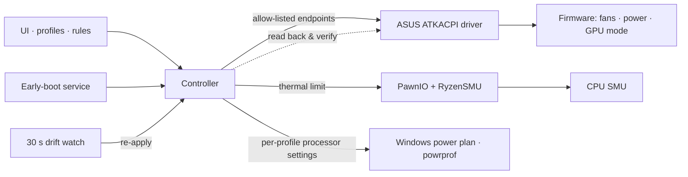

# TUF Control: details

## Requirements (enforced in [`src/Platform.cs`](../src/Platform.cs))

| | Rule | If not met |
|---|---|---|
| Windows | 10 2004 (build 19041) or newer, x64 | App won't start |
| Laptop | ASUS TUF Gaming A16 **FA607NUQ** | Runs read-only (monitoring only) |
| BIOS | FA607NUQ.300 tested | Runs, warning in the log |
| ASUS driver | ASUS System Control Interface v3 (`ATKACPI`) | No fan / power control |
| CPU temperature target | Ryzen "Rembrandt" CPU + [PawnIO](https://github.com/namazso/PawnIO) 2.x | Only that feature is off |
| GPU readings | NVIDIA driver | GPU sensors show "—" |
| Linux / macOS | Not supported; use [asusctl](https://gitlab.com/asus-linux/asusctl) | — |

Tested on: TUF Gaming A16 FA607NUQ, BIOS FA607NUQ.300, Ryzen 7 170, RTX 4050 Laptop
(driver 32.0.15.9162), Windows 11 Pro 26H2 build 26300.9711, ASUS System Control Interface
v3 3.1.73.0, PawnIO 2.2.0.0.

## Command line

| Command | What it does |
|---|---|
| `TufControl.exe --verify [profile]` | Compares live firmware state with the profile, writes `verify.json`; exit `0` = match |
| `TufControl.exe --diagnose [file]` | Hardware / platform report for bug reports |
| `TufControl.exe --read-only` | UI that never writes to hardware |
| `TufControl.exe --render <folder> [--lang en]` | Renders every page to PNG |

## How it works



GPU mode, the CPU temperature limit and the Windows processor settings have a true readback. Fan
curves, performance mode and power limits are confirmed by the firmware accepting the write.

## Windows processor settings

The firmware sets the ceilings (watts, temperature, fans); Windows picks the clock inside them. A
profile can take over that Windows side: minimum processor state, maximum frequency, processor boost
and energy performance preference. They are written to the plugged-in and battery values of the
active power plan (the plan itself is never switched), read back, and re-applied by the drift watch
if something else changes them. Switching to a profile that leaves this off restores the Windows
defaults, but only if TUF Control changed them in this session.

## Safety

- Writes only on verified models, and only to an allow-list of ACPI endpoints.
- Power and temperature values are clamped in the UI, the profile validation and the write layer.
- Fan curves keep at least 30 % from 70 °C, 70 % from 80 °C and 100 % from 90 °C.
- The firmware's own thermal protection always stays on.

## Build from source

```powershell
dotnet publish src/TufControl.csproj -c Release -o publish
.\Install.ps1   # administrator
```

Adding a laptop model: see [CONTRIBUTING.md](../CONTRIBUTING.md).
